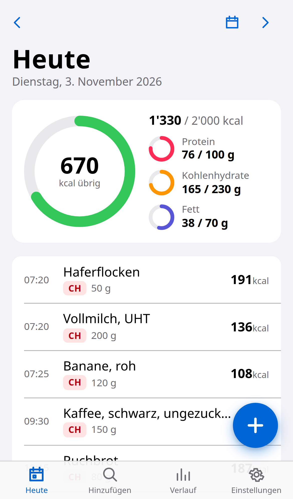
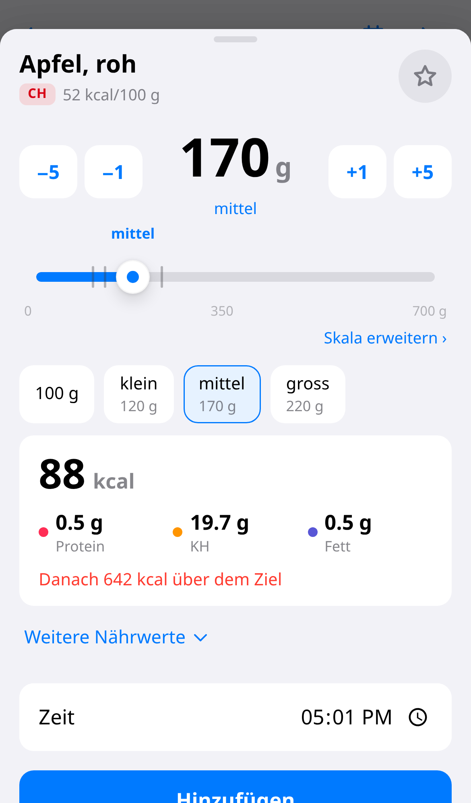
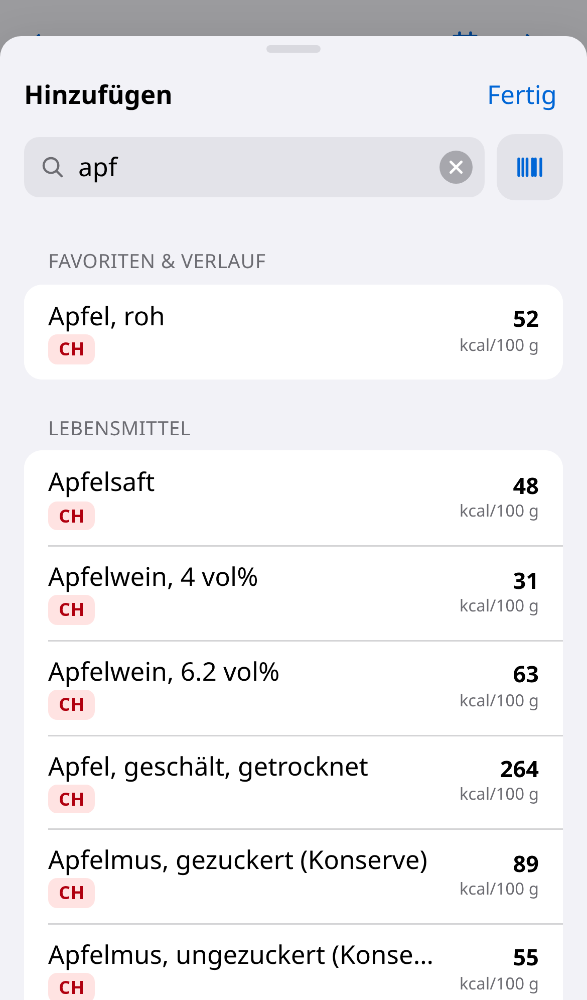
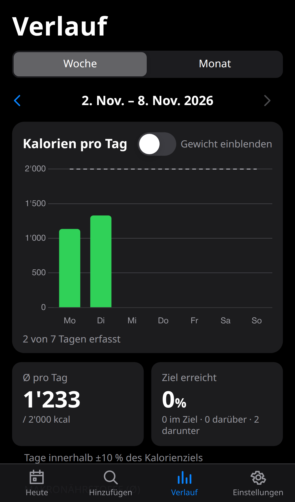
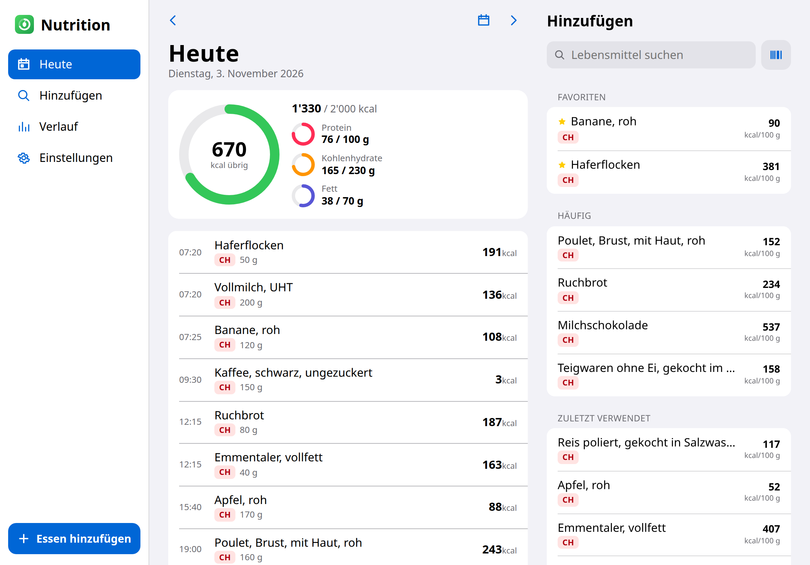
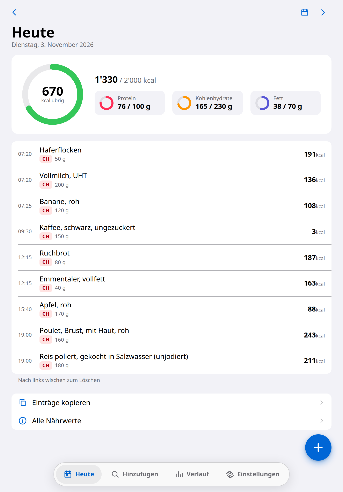
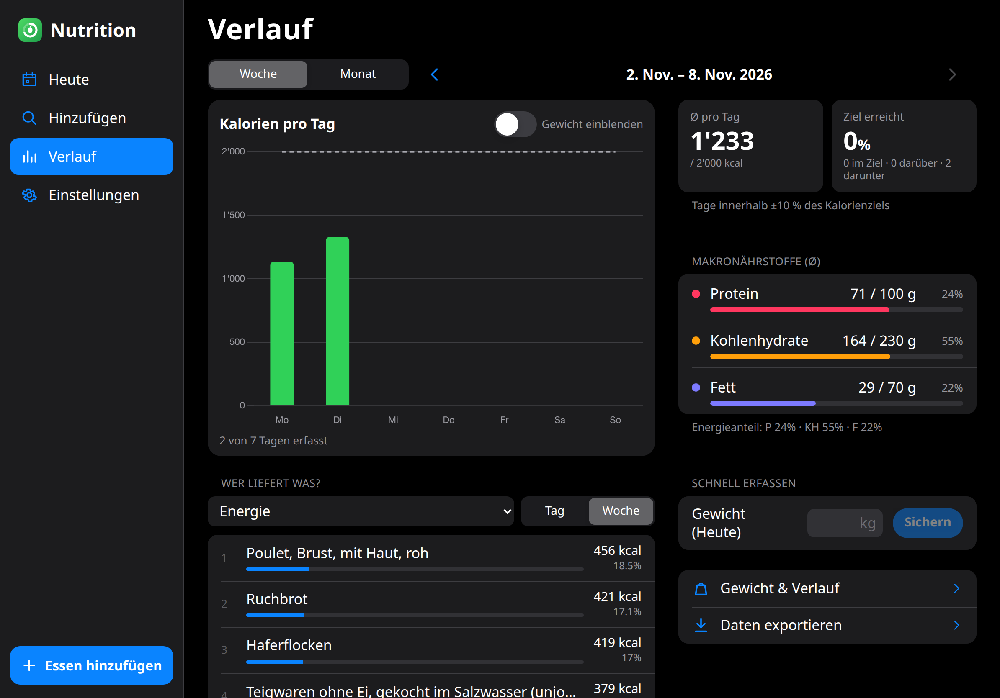
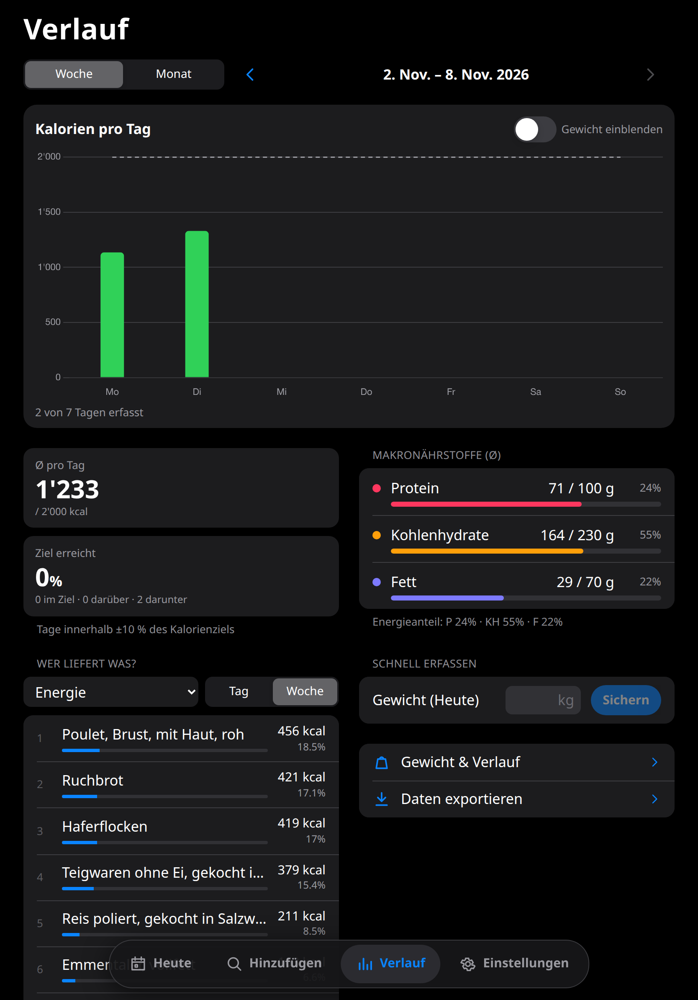

# Nutrition

A self-hosted, single-user calorie and nutrition tracker. It runs as a PWA and is built for
an iPhone installed to the home screen, with dedicated layouts for iPad (portrait and landscape),
laptops and ultrawide monitors. German (Swiss) and English.

- **Passkey login only** (Face ID / Touch ID via WebAuthn). No passwords.
- **Fast local food search** over the Swiss Food Composition Database (≈1'250 generic foods,
  German names; SQLite FTS5 with prefix and compound-word matching: `apf` → _Apfel_,
  `brot` → _Vollkornbrot_, `muesli` → _Müesli_).
- **Packaged products** from Open Food Facts: barcode scanning (ZXing WASM, works in iOS Safari)
  and online search. Every product is cached locally.
- **USDA FoodData Central** as an optional fallback (free API key).
- **Custom foods**, including a barcode, per-100 g or per-serving values and your own portions.
- **Recipes** with optional cooked weight and servings; nutrition per 100 g and per serving.
- **Portion picker**: a large slider with magnetic snap points at typical portions (curated
  file with 204 rules: _Banane klein/mittel/gross_, _1 Scheibe Brot_, _1 Ei_, …), presets,
  ±1/±5 buttons with long-press acceleration, exact input and a live nutrition preview.
- **Day view**: progress rings for kcal and macros, a timeline, swipe-to-delete with undo,
  editing, copying entries between days, favourites and recents.
- **Insights**: weekly and monthly charts, adherence, macro averages, weight trend
  (7-day average) and a "top sources" breakdown for any nutrient.
- **Export/import**: full JSON backup and restore; CSV for entries and weights.

| Today                                    | Portion picker                                    | Search                                    | Insights (dark)                            |
| ---------------------------------------- | ------------------------------------------------- | ----------------------------------------- | ------------------------------------------ |
|  |  |  |  |

**iPad**: portrait uses a floating tab bar, centred form sheets and two-column insights.
Landscape adds sidebar navigation, a Today split view with the food search inline, and
split-view settings.

| iPad landscape                                            | iPad portrait                                            |
| --------------------------------------------------------- | -------------------------------------------------------- |
|    |    |
|  |  |

**Laptop and monitor**: the iPad landscape layout, with two-column detail pages from 1400 px. From
1800 px Today adds an all-nutrients pane and Insights uses three columns, and past 2560 px the
whole app is centred.

All screens, light and dark: [`docs/screenshots/`](docs/screenshots).

## Stack

SvelteKit 3 (Svelte 5 runes, TypeScript, `adapter-node`) · SQLite (`better-sqlite3`) + Drizzle
ORM · `@simplewebauthn` · `barcode-detector`/`zxing-wasm` · Chart.js (lazy-loaded, tree-shaken) ·
Vitest · Playwright · Docker.

## Local development

Requirements: Node ≥ 22. Use **npm 11** for installs (`npx npm@11 install`); npm 10 hits a
known arborist bug with this dependency tree.

```bash
npx npm@11 install
cp .env.example .env          # then set ORIGIN=http://localhost:5173, RP_ID=localhost,
                              # SETUP_TOKEN=dev-setup-token, DATABASE_PATH=data/nutrition.db
npm run import:swissfcd       # XLSX → data/swissfcd.json → SQLite (idempotent)
npm run dev                   # http://localhost:5173
```

Open `http://localhost:5173/setup?token=dev-setup-token` to register a passkey. Browsers
allow WebAuthn on `localhost` without HTTPS.

### Scripts

| Script                            | Purpose                                                                                 |
| --------------------------------- | --------------------------------------------------------------------------------------- |
| `npm run dev`                     | Vite dev server                                                                         |
| `npm run build` / `npm start`     | Production build / start (migrations + data import + server)                            |
| `npm run check`                   | `svelte-check` (TypeScript)                                                             |
| `npm run lint` / `npm run format` | Prettier + ESLint                                                                       |
| `npm run test:unit`               | Vitest (nutrition math, adapters with recorded fixtures, auth, domain, i18n)            |
| `npm run test:e2e`                | Playwright E2E on emulated iPhone, iPad, laptop and ultrawide, Chromium + WebAuthn      |
| `npm run screenshots`             | Capture the main screens on every device class, light and dark, into `docs/screenshots` |
| `npm run import:swissfcd`         | Import the Swiss food DB (`--download` refreshes the official XLSX files)               |
| `npm run recovery`                | Print a one-time passkey registration link                                              |
| `npm run backup`                  | Online SQLite backup (`node scripts/backup.js [dir] [keep]`)                            |
| `npm run db:generate`             | Generate a Drizzle migration after schema changes                                       |
| `npm run icons`                   | Re-render PWA icons from `static/favicon.svg`                                           |

## Deployment

`./deploy.sh` does the whole deployment to a Debian/Ubuntu VM: it installs Docker, uploads the
project, creates the secrets, builds and starts the container and prints the setup link.
See **[DEPLOYMENT.md](DEPLOYMENT.md)**, including the reverse proxy and Let's Encrypt setup.

## Architecture

```
src/
  hooks.server.ts            auth gate, auth rate limiting, security headers, startup init
  lib/
    nutrients.ts             nutrient registry (keys, units, groups)
    nutrition.ts             pure math: scaling, recipes, aggregation, missing data, moving avg
    slider.ts                portion slider math (range, magnetic snapping)
    i18n/                    typed message catalogs (de = source of truth, en) + Swiss formatting
    api.ts                   typed client for the JSON API
    components/              PortionPicker, PortionSlider, Sheet, AddPanel, BarcodeScanner, Ring, …
    stores/                  global UI state (sheets, picker, toasts) and app settings
    server/
      config.ts              env-based configuration (shared with CLI scripts)
      db/                    Drizzle schema + connection (migrations in /drizzle, incl. FTS5)
      auth/                  sessions, setup/recovery tokens, WebAuthn
      foods/                 FoodSource interface, Open Food Facts + USDA adapters,
                             local FTS search, caching service, portion presets
      log.ts customFoods.ts weights.ts insights.ts backup.ts settings.ts
  routes/                    pages + typed JSON API under /api
scripts/                     start (entrypoint), import-swissfcd, recovery, backup
data/                        official Swiss DB XLSX files, portion presets, search aliases
e2e/                         Playwright specs + mock Open Food Facts server (recorded fixtures)
```

Key design points:

- **Foods** store nutrients **per 100 g/ml** as JSON. A missing key means _unknown_, never 0.
  Aggregates count the items missing each nutrient, and the UI shows "incomplete data" hints.
- **Log entries** keep a snapshot of the food (name and per-100 values), so history doesn't
  change when a custom food is edited later.
- **Food sources** implement a common `FoodSource` interface (`search`, `lookupBarcode`,
  `sourceUrl`). The adapters are tested against recorded API responses, with no network in tests.
- **The portion picker** opens with `openPicker({ food, amount?, date, mode })` from anywhere.
  A future AI estimator (e.g. a swappable `NutritionEstimator`) can propose food + grams and
  hand them to this same picker for confirmation.

## Data sources and licenses

- **Swiss Food Composition Database**, Federal Food Safety and Veterinary Office (FSVO/BLV),
  [naehrwertdaten.ch](https://naehrwertdaten.ch). Free use, including in apps, with source
  credited.
- **Open Food Facts**: [ODbL](https://opendatacommons.org/licenses/odbl/1-0/), individual
  contents under DbCL. The app follows the
  [API rules](https://openfoodfacts.github.io/openfoodfacts-server/api/): custom User-Agent,
  stays under the rate limits, no search-as-you-type, and caches results.
- **USDA FoodData Central**: public domain (CC0). Cited as source.

Credits are shown in the app under _Einstellungen → Über & Quellen_. Details: [DECISIONS.md](DECISIONS.md).
