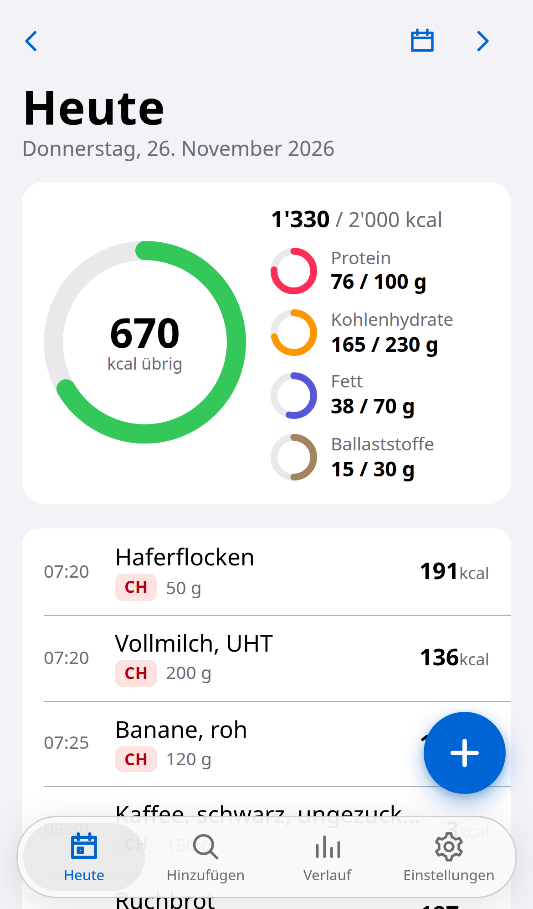
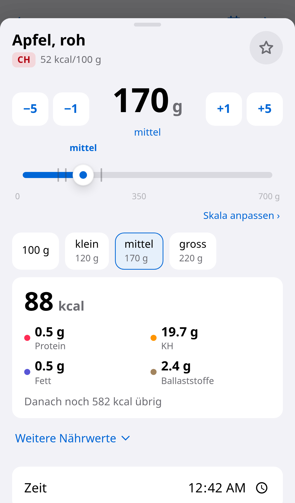
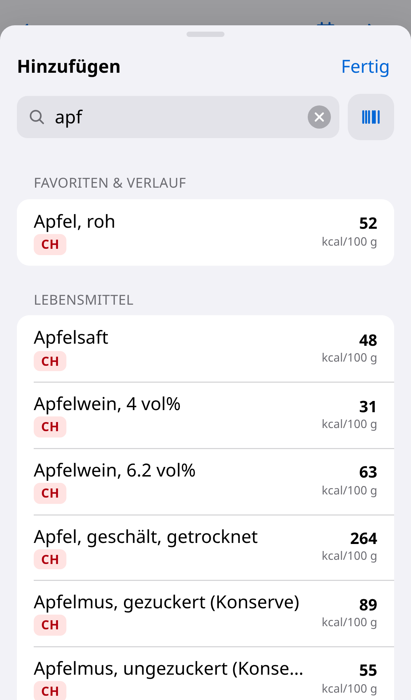
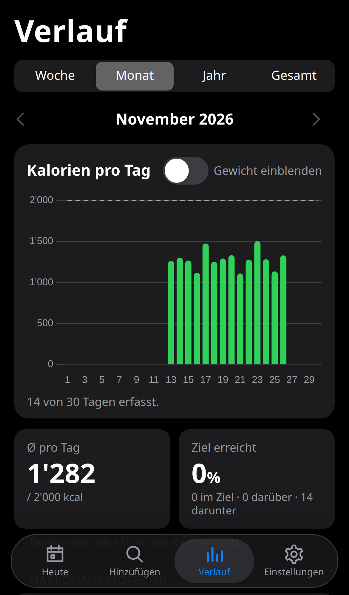
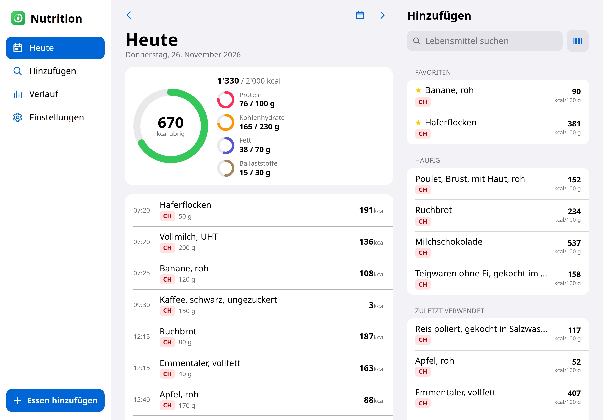
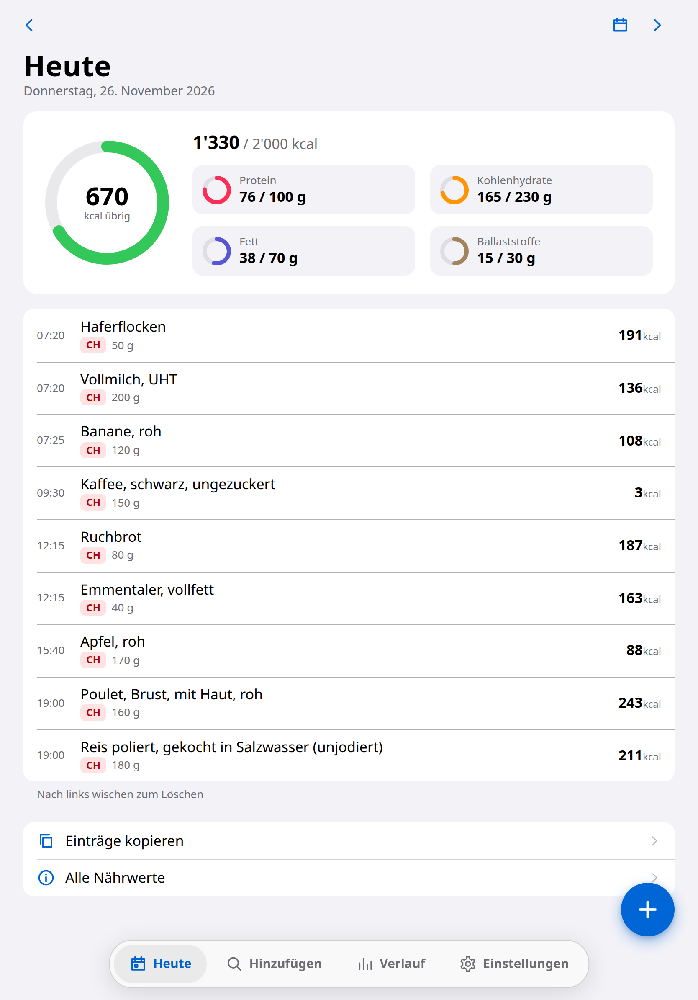
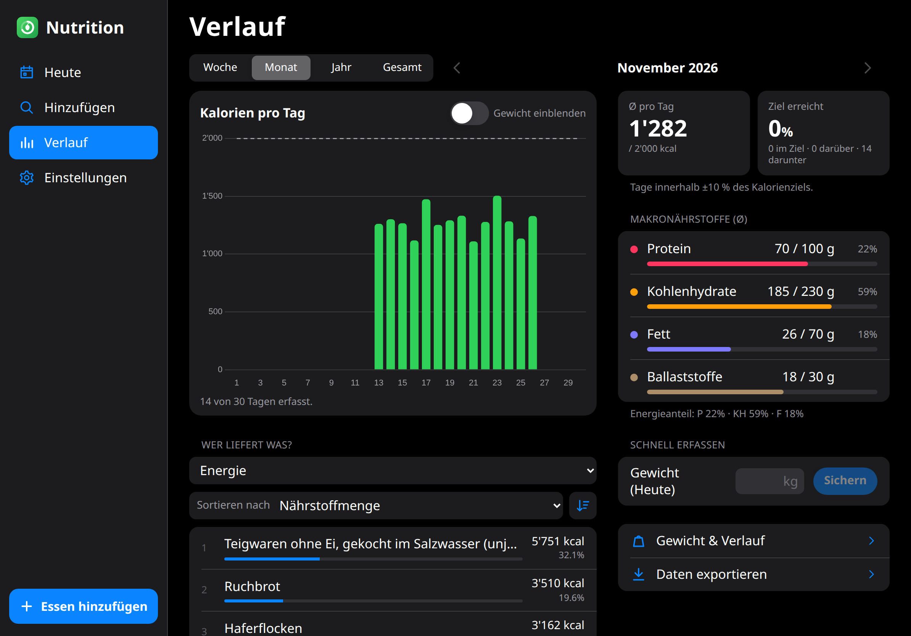
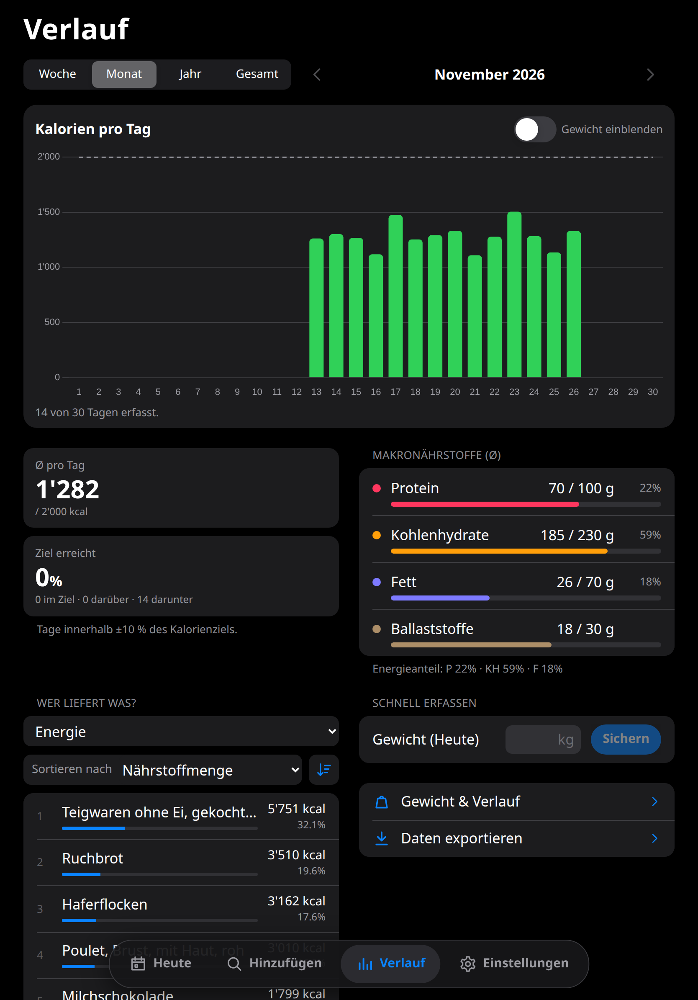

# Nutrition

A self-hosted, single-user calorie and nutrition tracker. It runs as a PWA and is built for
an iPhone installed to the home screen, with dedicated layouts for iPad (portrait and landscape),
laptops and ultrawide monitors. German (Swiss) and English.

- **Passkey login only** (Face ID / Touch ID via WebAuthn). No passwords.
- **Fast local food search** over the Swiss Food Composition Database (≈1'250 generic foods,
  German names; SQLite FTS5 with prefix and compound-word matching: `apf` → _Apfel_,
  `brot` → _Vollkornbrot_, `muesli` → _Müesli_).
- **Packaged products** from Open Food Facts: barcode scanning (ZXing WASM, works in iOS Safari)
  and online search. Every product is cached locally.
- **USDA FoodData Central** as an optional fallback (free API key).
- **Custom foods**, including a barcode, per-100 g or per-serving values and your own portions.
- **Recipes** with optional cooked weight and servings; nutrition per 100 g and per serving.
- **Portion picker**: a large slider with magnetic snap points at typical portions (curated
  file with 204 rules: _Banane klein/mittel/gross_, _1 Scheibe Brot_, _1 Ei_, …), presets,
  ±1/±5 buttons with long-press acceleration, exact input and a live nutrition preview.
- **Day view**: progress rings for kcal and macros, a timeline, swipe-to-delete with undo,
  editing, copying entries between days, favourites and recents.
- **Insights (Verlauf)**: one switch for week, month, year or all time drives the charts (paged
  back to the first entry), adherence and macro averages, and the "top sources" breakdown for any
  nutrient. Figures compare with your current targets or, once targets changed, with the targets
  that applied at the time.
- **Weight**: 7-day trend over 30 days, 90 days, a year or everything; the full history loads page
  by page, and deletions can be undone.
- **Export/import**: full JSON backup and restore; CSV for entries and weights.
- **Incremental backups**: a daily base snapshot plus append-only change journal in a host
  directory (see [Backups](docs/backups.md)).

| Today                                    | Portion picker                                    | Search                                    | Insights (dark)                            |
| ---------------------------------------- | ------------------------------------------------- | ----------------------------------------- | ------------------------------------------ |
|  |  |  |  |

**iPad**: portrait uses a floating tab bar, centred form sheets and two-column insights.
Landscape adds sidebar navigation, a Today split view with the food search inline, and
split-view settings.

| iPad landscape                                            | iPad portrait                                            |
| --------------------------------------------------------- | -------------------------------------------------------- |
|    |    |
|  |  |

**Laptop and monitor**: the iPad landscape layout, with two-column detail pages from 1400 px. From
1800 px Today adds an all-nutrients pane, Insights uses three columns and the detail pages widen;
on an ultrawide the app uses the full width.

## Stack

SvelteKit 3 (Svelte 5 runes, TypeScript, `adapter-node`) · SQLite (`better-sqlite3`) + Drizzle
ORM · `@simplewebauthn` · `barcode-detector`/`zxing-wasm` · Chart.js (lazy-loaded, tree-shaken) ·
Vitest · Playwright · Docker.

## Quick start

```sh
npx npm@11 install
cp .env.example .env          # see docs/development.md for local values
npm run import:swissfcd
npm run dev                   # http://localhost:5173
```

To run it in production you need Docker, a domain and an HTTPS reverse proxy:
[what has to run](docs/deployment/README.md), and a
[step-by-step example on a V-Server](docs/deployment/vserver.md).

## Documentation

The [docs/](docs/README.md) folder is the project wiki, with one short page per topic:
[architecture](docs/architecture.md), [development](docs/development.md),
[data model](docs/data.md), [backups](docs/backups.md), [food data](docs/food-data.md),
[auth](docs/auth.md), [frontend](docs/frontend.md) and [deployment](docs/deployment/README.md).
The reasons behind the design choices are in [DECISIONS.md](DECISIONS.md).

## Data sources and licenses

- **Swiss Food Composition Database**, Federal Food Safety and Veterinary Office (FSVO/BLV),
  [naehrwertdaten.ch](https://naehrwertdaten.ch). Free use, including in apps, with source
  credited. The files are not in this repository: they are downloaded from the FSVO at import
  or build time.
- **Open Food Facts**: [ODbL](https://opendatacommons.org/licenses/odbl/1-0/), individual
  contents under DbCL. The app follows the
  [API rules](https://openfoodfacts.github.io/openfoodfacts-server/api/): custom User-Agent,
  stays under the rate limits, no search-as-you-type, and caches results.
- **USDA FoodData Central**: public domain (CC0). Cited as source.

The project's code license does not cover this data: see [DATA_NOTICE.md](DATA_NOTICE.md).
Credits are shown in the app under _Einstellungen → Über & Quellen_. Details: [DECISIONS.md](DECISIONS.md).

## License

The source code is under the [MIT License](LICENSE). Food data, test fixtures and the data shown in
screenshots are not: see [DATA_NOTICE.md](DATA_NOTICE.md). Each build generates the license texts
of the bundled third-party software, which the app links to under _Über & Quellen_.
